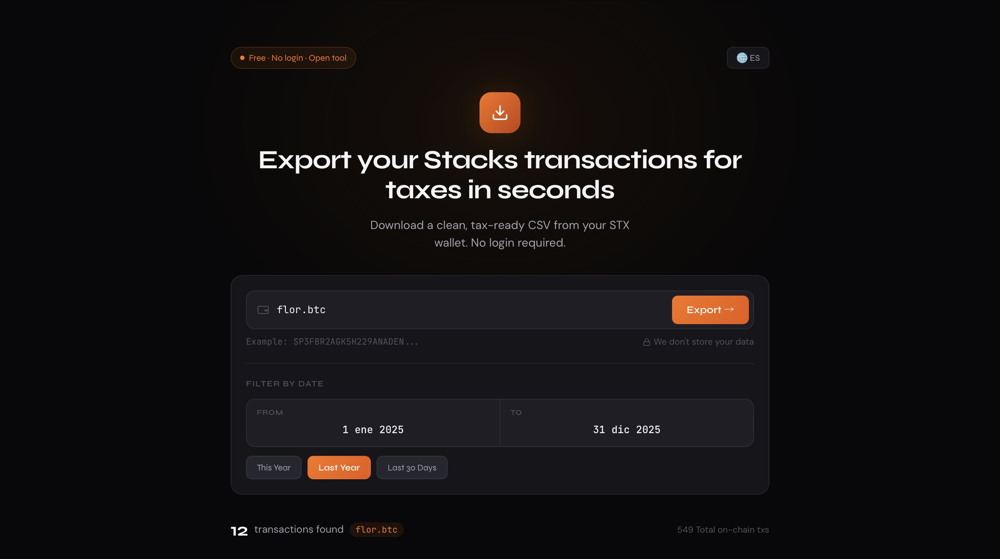

# 🟣 Stacks Tax & Data Export Layer

> **StacksCSV** is the missing data layer for Stacks: it converts raw blockchain activity into **clean, tax-ready CSV exports** compatible with Koinly, CoinTracking, and Awaken.



## 🌍 Live App

**[stackscsv.vercel.app](https://stackscsv.vercel.app)**

No signup. No wallet connection. Enter an address or a `.btc` name — get a CSV in seconds.

---

## 🚨 The Problem

Stacks lacks a reliable data export layer for tax reporting. Users face:

- **Broken or incomplete explorer exports** — missing columns, wrong timestamps, stuck pagination
- **Manual cleanup** before anything imports cleanly into tax tools
- **Misclassified transactions** in Awaken and Koinly
- **No PoX stacking reward exports** anywhere (until now)
- **No standard format** for STX, SIP-010 tokens, or Bitcoin rewards

## 💡 The Solution

StacksCSV is a focused tool that does one thing well: pulls your Stacks history and formats it exactly the way tax tools expect.

- Clean STX transaction extraction
- SIP-010 fungible token support (ALEX, WELSH, sBTC, USDA, DIKO, +)
- **PoX stacking rewards** denominated in BTC
- Nakamoto-era & pre-Nakamoto timestamps handled correctly
- Date filtering by tax year
- Output compatible with every major crypto tax platform
- No login, no data storage, client-safe processing

---

## ⚡ Features

### 📤 Transaction export
- All STX transfers (sent, received, self)
- SIP-010 fungible token transfers with symbol & decimals auto-resolved
- Correct fee attribution (sender only, first row per tx)

### ₿ PoX stacking rewards
- Automatically detects your Stacks address's PoX reward BTC address
- Supports **P2PKH, P2SH, P2WPKH, P2WSH, and P2TR** Bitcoin address formats (full Base58Check + Bech32/Bech32m encoding)
- Resolves each reward cycle's exact Bitcoin block timestamp
- Reported as BTC income rows — exactly how Koinly expects stacking rewards

### 📅 Date filtering
- Quick presets: **This Year · Last Year · Last 30 Days**
- Custom date ranges with mobile-safe inputs (no iOS zoom issues)

### 🧾 Tax summary dashboard
- STX received / sent / fees / transaction count
- BTC earned from stacking (separate stacking rewards card)
- Condensed line summary of other tokens detected (included in CSV)

### 🌐 BNS name support
- Enter `flor.btc` instead of a long `SP…` address
- Resolution happens via the **on-chain BNS Clarity contract** — not a REST API

### 🌎 Bilingual UI
- English / Español toggle
- All error messages, labels, and summaries translated

### 🔒 Privacy-first
- No accounts, no stored data, nothing persisted server-side beyond a 2-minute in-memory cache
- All blockchain data fetched on-demand

---

## 🏗 Architecture

StacksCSV is a **Next.js app** running on Vercel. Blockchain data goes through two paths depending on what's needed:

| What it's getting | How it gets it |
|---|---|
| **BNS name resolution** | Direct call to the BNS **Clarity smart contract** (`SP000000000000000000002Q6VF78.bns`) via the public RPC endpoint `/v2/contracts/call-read/` — no API key needed |
| **Transaction history** | Hiro `/extended/v1/address/{addr}/transactions_with_transfers` — authenticated with `HIRO_API_KEY` |
| **FT token metadata** | Hiro `/metadata/v1/ft/{contract}` + hardcoded cache of known tokens — authenticated |
| **PoX stacking state** | Hiro `/extended/v2/addresses/{addr}/stacking` → `/extended/v1/burnchain/rewards/` → `/extended/v2/burn-blocks/` |

### Why on-chain BNS resolution?

Hiro deprecated their REST BNS endpoints (`/v1/names/`, `/v2/bns/names/`, etc.) in late 2026. Instead of chasing REST endpoint changes, StacksCSV calls the BNS **Clarity smart contract directly**. The contract is immutable on the blockchain — it will never be deprecated, moved, or taken down.

---

## 🚀 Quick Start

### Prerequisites
- Node.js 18+
- A free Hiro API key from [platform.hiro.so](https://platform.hiro.so) (optional for BNS, required for transaction history at any volume)

### Install

```bash
git clone https://github.com/flormpecasique/StacksCSV.git
cd StacksCSV
npm install
```

### Environment variables

Create a `.env.local` file in the project root:

```
HIRO_API_KEY=your_hiro_api_key_here
```

> **Note:** BNS resolution works without an API key. Transaction and stacking lookups will hit rate limits from shared cloud IPs without one — strongly recommended for production.

### Run

```bash
npm run dev
```

Open [http://localhost:3000](http://localhost:3000).

---

## 🌐 Deploy

### Vercel (recommended)

1. Push the code to GitHub
2. Import the project into Vercel
3. Add `HIRO_API_KEY` as an environment variable (Production, Preview, Development)
4. Deploy

### CLI

```bash
vercel
```

Set `HIRO_API_KEY` in your project settings afterwards.

---

## 🛠 Tech Stack

- **Framework:** Next.js 14 (App Router)
- **Language:** TypeScript (strict mode, ES2020 target)
- **Styling:** Tailwind CSS
- **Blockchain:**
  - Hiro Stacks API for transaction history, token metadata, stacking data
  - Stacks RPC (`/v2/contracts/call-read/`) for on-chain BNS resolution
- **Hosting:** Vercel (serverless functions + edge caching)

---

## 🧠 Why This Matters

Stacks has no dependable tax data layer. **StacksCSV isn't trying to be your next subscription.** It's a free tool that exports your transaction history in the exact format tax platforms expect — nothing more, nothing less.

---

## ⚡ Performance

- Serverless-ready and optimized for Vercel
- No database required
- Fast in-memory caching (2-minute TTL per address)
- Parallel pagination (5 batches concurrently) for addresses with many transactions
- Minimal bundle size with no heavy UI libraries

---

## 🔮 Roadmap

- ✅ SIP-010 token support (ALEX, WELSH, sBTC, USDA, DIKO, …)
- ✅ Stacking rewards export (PoX) — BTC earned from all cycles
- ✅ Nakamoto-era timestamp precision
- ✅ `.btc` name resolution via on-chain contract
- ✅ Bilingual EN / ES interface
- ✅ Mobile-first responsive design
- 🚧 Smart contract transaction parsing (DeFi interactions)
- 🚧 Multi-wallet aggregation (export multiple addresses at once)
- 🚧 Persistent edge caching with Vercel KV

---

## 🤝 Use Cases

- End-of-year **tax reporting** for Stacks users
- **Crypto accountants** needing standardized CSV input
- **Stackers** tracking BTC rewards across cycles
- Preparing clean data for **Awaken, Koinly, CoinTracking**

---

## 🧡 Donate

If this saved you time this tax season, consider tipping: **`flor.btc`**

---

## 📄 License

MIT — fork it, extend it, use it in whatever you build.
